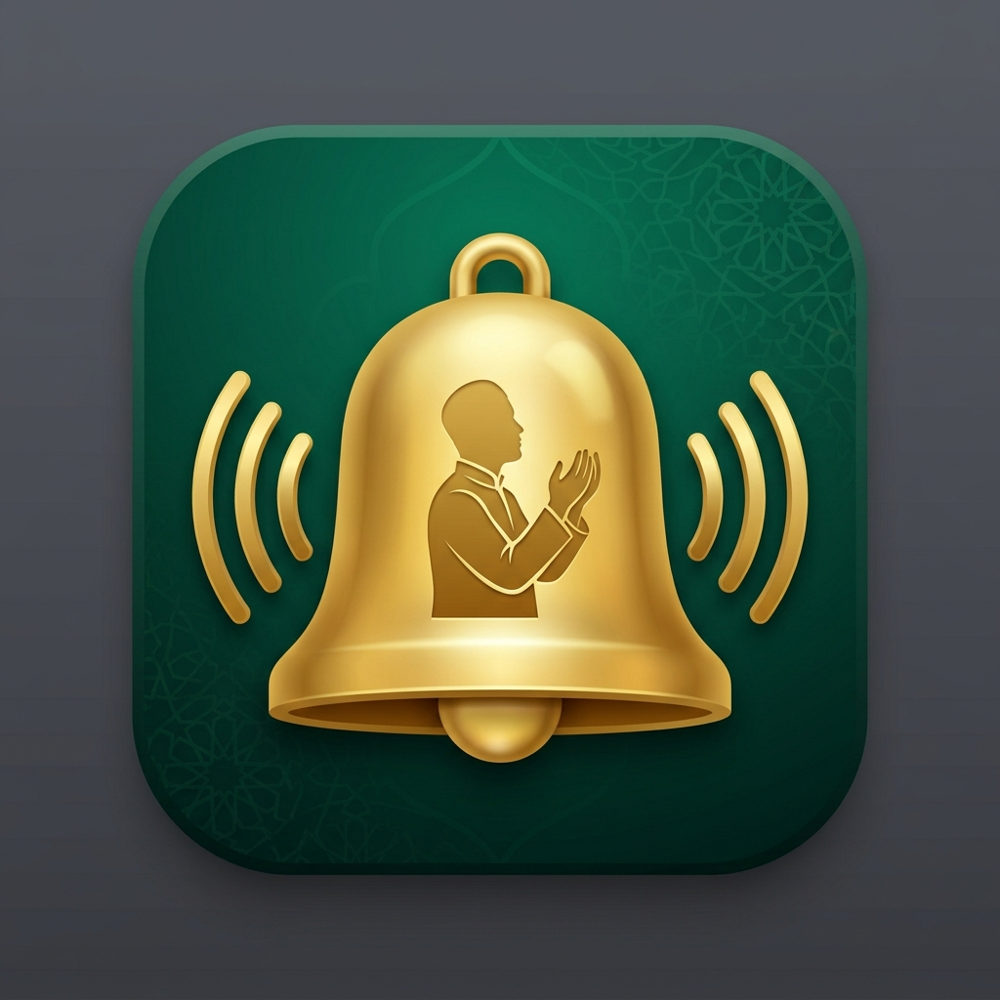
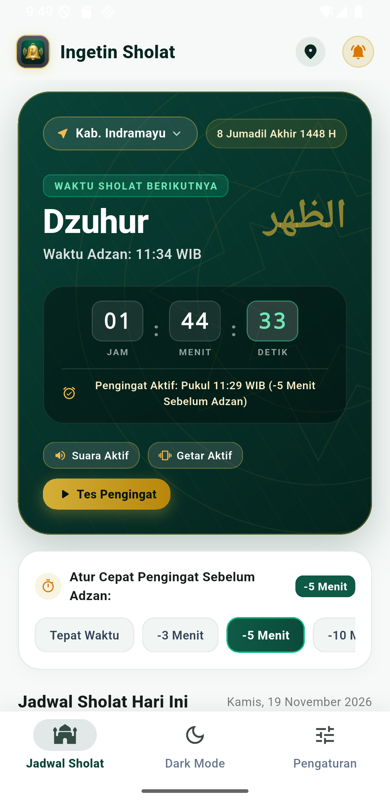
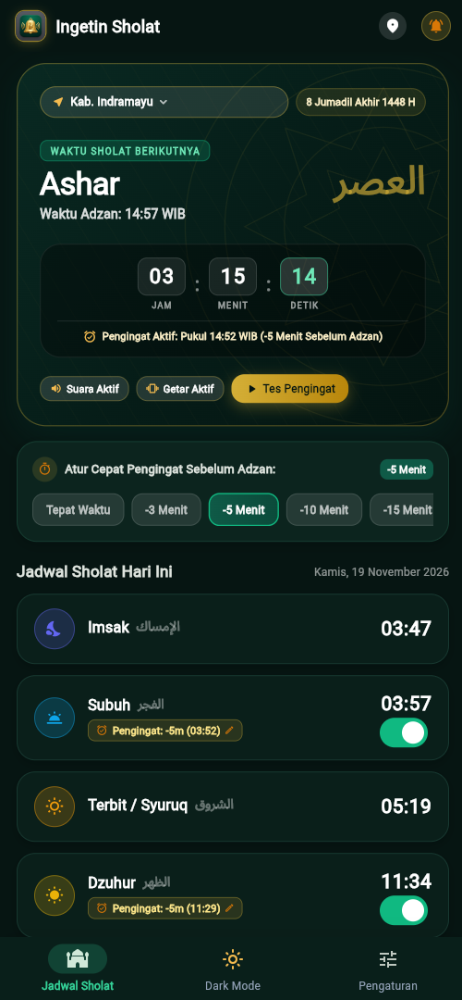

<p align="center">
  
</p>

<h1 align="center">Ingetin Sholat</h1>

<p align="center">
  <b>Aplikasi Pengingat Waktu Adzan Elegan, Responsif, Akurat & 100% Offline se-Indonesia</b>
</p>

<p align="center">
  
  
  
  
  
  
  
</p>

---

## 📖 Tentang Aplikasi

**Ingetin Sholat** adalah aplikasi mobile (Android, iOS) & Web yang dirancang khusus untuk mempermudah umat Islam memantau jadwal sholat harian serta mendapatkan alarm pengingat sebelum adzan berkumandang. 

Berbeda dengan aplikasi pada umumnya yang mengandalkan koneksi internet untuk memanggil API pihak ketiga, **Ingetin Sholat bekerja 100% murni secara Offline** menggunakan formula **Hisab Astronomis Matahari** standar Kementerian Agama Republik Indonesia (Kemenag RI) dan telah memuat database lebih dari **345 Kabupaten & Kota di 38 Provinsi Indonesia**.

---

## ✨ Fitur-Fitur Unggulan

### 1. ⏱️ Kustomisasi Waktu Pengingat Sebelum Adzan (User Controlled)
- Pengguna bebas mengatur berapa menit alarm berbunyi sebelum adzan tiba (contoh: `-5 menit`, `-10 menit`, `-15 menit`, atau tepat waktu adzan).
- **Contoh Kasus Nyata**: Waktu Dzuhur jatuh pada pukul **11:34 WIB**. Jika pengguna menyetel pengingat `-5 menit`, maka alarm dan getaran akan berbunyi tepat pukul **11:29 WIB** agar pengguna dapat segera bersiap mengambil wudhu dan menuju masjid.
- Tersedia bar pilihan cepat (*Quick Select Chips*) langsung di halaman utama.

### 2. 📍 Kota Default: Indramayu & Cakupan 345+ Kota Seluruh Indonesia
- **Kota Bawaan (Default)**: **Kab. Indramayu (Jawa Barat)** dengan koordinat astronomis `-6.3333 LS` dan `108.3167 BT` (Zona Waktu WIB).
- Mendukung pencarian instan dan filter wilayah untuk seluruh 38 Provinsi di Indonesia:
  - **Sumatera** (WIB / GMT+7)
  - **Jawa & Banten** (WIB / GMT+7)
  - **Bali & Nusa Tenggara** (WITA / GMT+8)
  - **Kalimantan** (WIB & WITA)
  - **Sulawesi** (WITA / GMT+8)
  - **Maluku & Papua** (WIT / GMT+9)

### 3. 🌙 Penanggalan Hijriah Akurat & Hitung Mundur Real-Time
- Penanggalan Hijriah astronomis terpadu (contoh: **8 Jumadil Akhir 1448 H**).
- Kartu utama (*Hero Card*) bergaya mewah warna Zamrud (*Imperial Emerald*) dan Emas (*Royal Gold*) dengan ornamen geometris Islam 8 sudut (*Rub el Hizb*).
- Hitung mundur digital (*live countdown*) format 3 blok: `JAM : MENIT : DETIK`.

### 4. 🧭 Navigasi 3 Tombol Praktis
Bilah navigasi bawah dirancang sederhana dan ergonomis:
1. **Jadwal Sholat**: Menampilkan kartu hero sholat berikutnya, pemilih offset cepat, dan jadwal 7 waktu (Imsak, Subuh, Syuruq, Dzuhur, Ashar, Maghrib, Isya).
2. **Dark Mode**: Satu tombol pintas untuk langsung beralih antara Mode Gelap (*Dark Obsidian*) dan Mode Terang (*Light Ivory*).
3. **Pengaturan**: Menu pengaturan terfokus dan bersih (tanpa opsi yang redundan).

### 5. 🔔 Kontrol Notifikasi, Bunyi Adzan & Getar
- Pilihan nada suara & pengingat: *Nada Standar Sistem (Ringtone), Beep Alarm Pengingat, dan Nada Notifikasi Lembut*.
- Tombol uji coba langsung (**"Tes Pengingat"**) untuk mendengarkan bunyi dan merasakan getaran haptic.

---

## 📱 Tangkapan Layar (Screenshots)

<p align="center">
  
  
  
</p>

---

## 📐 Arsitektur & Teknologi

Aplikasi ini dibangun menggunakan arsitektur **Clean Architecture (Domain, Data, Presentation)** dan manajemen state **BLoC Pattern** untuk keterbacaan kode, skalabilitas, serta kemudahan pengujian (*testability*).

```
lib/
├── app/
│   └── theme/                       # Palet warna Material 3 (Emerald, Gold, Obsidian)
├── core/
│   ├── constants/
│   │   ├── app_constants.dart       # Enums, keys SharedPreferences, konstanta global
│   │   └── indonesia_cities_data.dart # Database 345+ Kabupaten/Kota se-Indonesia
│   ├── utils/
│   │   ├── audio_helper.dart        # Simulasi audio & haptic feedback
│   │   ├── date_formatter.dart      # Konversi Hijriyah (Ummul Qura) & tanggal lokal
│   │   ├── islamic_pattern_painter.dart # CustomPainter ornamen bintang 8 Rub el Hizb
│   │   ├── prayer_calculator.dart   # Formula hisab astronomis posisi matahari
│   │   └── responsive_layout.dart   # Breakpoints responsif multi-perangkat
│   └── widgets/
│       └── ingetin_sholat_logo.dart # Widget logo resmi lonceng bergetar & siluet doa
├── features/prayer_time/
│   ├── domain/
│   │   ├── entities/                # PrayerScheduleEntity, ReminderSettings
│   │   ├── repositories/            # PrayerRepository interface
│   │   └── usecases/                # Use cases jadwal & pengaturan
│   ├── data/
│   │   ├── datasources/             # SettingsLocalDataSource (SharedPreferences)
│   │   └── repositories/            # PrayerRepositoryImpl
│   └── presentation/
│       ├── bloc/                    # PrayerBloc, PrayerEvent, PrayerState
│       ├── pages/                   # MainNavigationScreen, HomePageView, SettingsPage
│       └── widgets/                 # NextPrayerHeroCard, PrayerTimeTile, Dialogs, Sheets
├── injection_container.dart         # Dependency Injection (GetIt)
└── main.dart                        # MaterialApp entry point
```

---

## 🧪 Pengujian & Kualitas Kode (Testing)

Proyek ini telah lulus seluruh unit test dan widget test dengan standar tertinggi:

```bash
# Menjalankan seluruh pengujian
flutter test

# Output:
# 00:02 +13: All tests passed!

# Pengecekan linter dan analisis kode
dart analyze

# Output:
# No issues found!
```

---

## 🚀 Cara Menjalankan Proyek

### Prasyarat:
- Flutter SDK `>= 3.50.0`
- Dart SDK `>= 3.14.0`
- Android Studio / VS Code / Android Emulator

### Langkah Instalasi:

1. **Clone Repositori**:
   ```bash
   git clone https://github.com/800sudo/ingetin-sholat.git
   cd ingetin-sholat
   ```

2. **Pasang Dependensi**:
   ```bash
   flutter pub get
   ```

3. **Jalankan Aplikasi**:
   - Di Android Emulator:
     ```bash
     flutter run
     ```
   - Di Web Browser (Offline Localhost):
     ```bash
     flutter run -d web-server --web-port=8080 --web-hostname=localhost
     ```
     Buka di browser: `http://localhost:8080`

4. **Build File APK**:
   ```bash
   flutter build apk
   ```
   File APK hasil kompilasi akan berada di direktori `build/app/outputs/flutter-apk/app-debug.apk`.

---

## 📞 Layanan Bantuan & Dukungan

Jika Anda membutuhkan bantuan, memiliki pertanyaan, atau ingin menyampaikan masukan:
- **WhatsApp / Telepon**: `089660626800`

---

## 📄 Lisensi

Didistribusikan di bawah lisensi **MIT License**. Lihat file `LICENSE` untuk rincian lebih lanjut.

---

<p align="center">
  Dibuat dengan ❤️ untuk kemudahan ibadah sholat tepat waktu di seluruh Indonesia.
</p>
